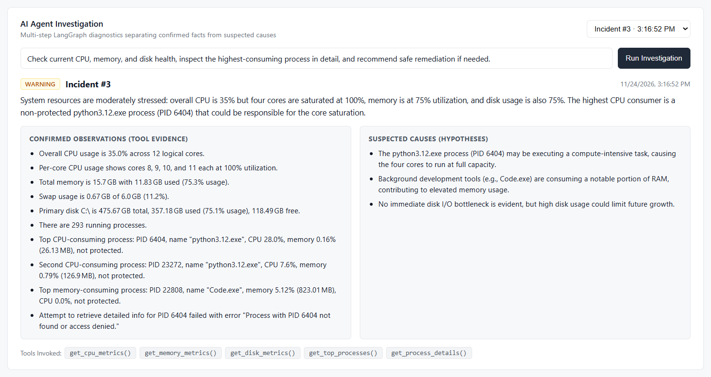
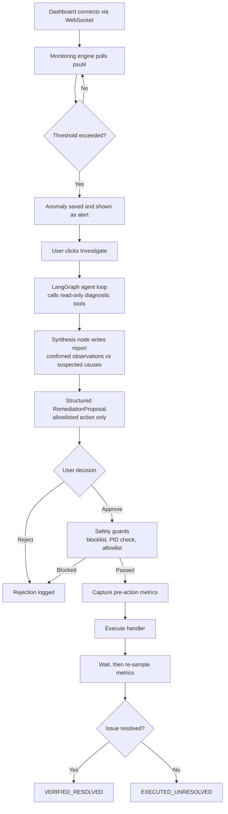
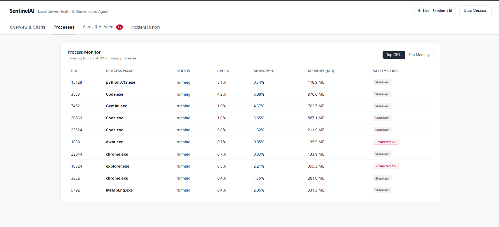
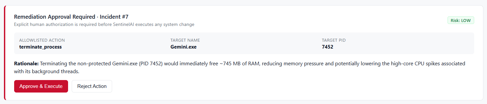

# SentinelAI
 
**Intelligent Monitoring. Controlled Remediation. Verified Outcomes.**
 
SentinelAI is a cross-platform server health monitoring application with an AI agent that investigates problems and proposes fixes. It watches a local Windows or Ubuntu Linux machine, detects resource anomalies, uses a tool-calling LLM agent to find the likely root cause, and runs a fix only after a human approves it. After every fix, it re-measures the system to confirm whether the problem was actually resolved.
 
Built with FastAPI, React, LangGraph, Groq, `psutil`, and SQLite.
 
)
 
---
 
## Table of Contents
 
- [Key Features](#key-features)
- [How It Works](#how-it-works)
- [Architecture](#architecture)
- [Technology Stack](#technology-stack)
- [Security and Safety Controls](#security-and-safety-controls)
- [Getting Started](#getting-started)
- [Usage Walkthrough](#usage-walkthrough)
- [Testing and Demo](#testing-and-demo)
- [API Reference](#api-reference)
- [Limitations and Future Work](#limitations-and-future-work)
- [Security Notes](#security-notes)
- [License](#license)
---
 
## Key Features
 
- **Live monitoring:** CPU, RAM, swap, disk, uptime, and per-process metrics streamed to a React dashboard over WebSockets.
- **Threshold-based anomaly detection:** Configurable warning and critical thresholds, with cooldown to avoid alert spam, automatic escalation from `WARNING` to `CRITICAL`, and automatic recovery reset.
- **AI root-cause investigation:** A LangGraph agent calls 7 read-only diagnostic tools and produces a report that separates confirmed observations from suspected causes.
- **Human-in-the-loop remediation:** The agent can only propose actions from a fixed allowlist. Nothing runs until a user approves it.
- **Verified outcomes:** Each executed action is followed by a fresh metric check, so the audit log records whether the issue was really fixed.
- **Full audit trail:** Anomalies, reports, proposals, decisions, safety checks, and verification results are all stored in SQLite.
- **Cross-platform:** Works on Windows 11 and Ubuntu Linux through OS-specific adapters.
---
 
## How It Works
 
![Agent workflow]
 

 
1. **Detect.** While a dashboard session is open, the backend collects metrics and compares them to thresholds.
2. **Investigate.** On user request, the agent runs a bounded loop of read-only tool calls (for example, inspecting top processes and resource usage) to gather evidence.
3. **Report.** A synthesis step writes a structured report. Facts returned by tools are kept separate from the agent's hypotheses.
4. **Propose.** The agent outputs a typed `RemediationProposal`. It cannot produce free-form commands.
5. **Approve.** The proposal stays `PENDING` in the database until a user approves or rejects it.
6. **Execute and verify.** Safety guards run, the action executes, and the system is re-measured to record the real outcome.
---
 
## Architecture
 
SentinelAI is a **modular monolith**: one deployable backend with strict boundaries between telemetry, detection, AI investigation, remediation, persistence, and presentation.
 
| Module | Path | Responsibility |
| :--- | :--- | :--- |
| Monitoring Engine | `backend/app/monitoring/` | Collects CPU, RAM, swap, disk, OS metadata, uptime, and process metrics via `psutil`. OS-specific mount filtering and protected-process lists live in `WindowsAdapter` and `LinuxAdapter`. |
| Anomaly Detection | `backend/app/anomalies/` | Evaluates snapshots against warning/critical thresholds with per-key cooldown, immediate escalation, and recovery resets. |
| AI Agent | `backend/app/agent/` | LangGraph ReAct-style tool-calling loop on Groq with 7 read-only tools, followed by a structured synthesis node. Also holds prompts and report schemas. |
| Remediation Engine | `backend/app/remediation/` | Allowlist registry, safety guards, action handlers, and the pre/post metric verifier. |
| API and Database | `backend/app/api/`, `backend/app/db/` | REST endpoints, session-scoped WebSocket manager, SQLAlchemy models, and repository layer. |
| Dashboard | `frontend/src/` | React + TypeScript SPA with live charts, process table, alerts, investigation reports, approval modal, and incident history. |
 
<details>
<summary>Full directory structure</summary>
```text
sentinelai/
├── backend/
│   ├── app/
│   │   ├── agent/          # LangGraph workflow, 7 read-only tools, prompts, report schemas
│   │   ├── anomalies/      # Threshold rules, cooldown deduplication, severity classifier
│   │   ├── api/            # REST routers, WebSocket session manager, shared dependencies
│   │   ├── db/             # SQLAlchemy engine, ORM models, repository CRUD layer
│   │   ├── monitoring/     # Cross-platform psutil collector, Windows & Linux adapters
│   │   ├── remediation/    # Allowlist registry, safety guards, handlers, metric verifier
│   │   ├── config.py       # Typed environment configuration via pydantic-settings
│   │   └── main.py         # FastAPI application entrypoint and lifespan hooks
│   ├── scripts/
│   │   └── load_simulator.py  # Controlled multi-core CPU and memory spike generator
│   ├── tests/              # Unit, security, cross-platform, and API integration tests
│   ├── .env.example
│   ├── pytest.ini
│   └── requirements.txt
└── frontend/
    └── src/
        ├── components/     # SystemOverview, ResourceCharts, ProcessTable, AlertsPanel,
        │                   # InvestigationReport, RemediationModal, IncidentHistory
        ├── services/       # Typed REST client and WebSocket stream hook
        ├── styles/         # Dashboard stylesheet
        └── types/          # Shared TypeScript API and telemetry interfaces
```
 
</details>
### Design decisions
 
- **Why threshold-based detection instead of ML?** Thresholds are predictable, explainable, and produce few false positives. The AI is used where it adds the most value: explaining *why* something is happening, not deciding *whether* something is wrong.
- **Why a modular monolith?** SentinelAI monitors a single host. One process with clear module boundaries is simpler to run, test, and demo than microservices.
- **Why session-scoped monitoring?** Polling starts when a dashboard connects and stops when the last client disconnects, so the tool uses no resources when nobody is watching.
---
 
## Technology Stack
 
| Layer | Technology |
| :--- | :--- |
| Frontend | React, TypeScript, Vite, Recharts |
| Backend | Python 3.12, FastAPI, Uvicorn |
| AI Agent | LangGraph, LangChain Core, Groq API |
| System Telemetry | `psutil` with Windows and Linux OS adapters |
| Database | SQLite with SQLAlchemy 2.0 ORM |
| Communication | REST and WebSockets |
| Testing | `pytest`, FastAPI `TestClient` |
 
---
 
## Security and Safety Controls
 
An agent that can act on a real machine needs strict limits. SentinelAI applies five layers of protection.
 
### 1. No arbitrary shell execution
 
The LLM never produces commands. It outputs a structured `RemediationProposal` whose action is restricted to an enum:
 
- `terminate_process`
- `restart_managed_service`
- `clear_temp_directory`
- `none`
### 2. Explicit user authorization
 
Proposed actions stay in `PENDING` state in SQLite until a user approves them via `POST /api/remediation/{id}/decide`.
 
### 3. OS protected-process blocklists
 
Critical processes are blocked even if an approved request targets them.
 
- **Windows:** `System`, `csrss.exe`, `wininit.exe`, `lsass.exe`, `svchost.exe`, and others.
- **Linux:** `systemd`, `init`, `sshd`, `dbus-daemon`, `dockerd`, and others.
### 4. PID reuse protection
 
Before terminating a process, the live OS process name at `target_pid` is compared with the `target_name` recorded during investigation. If they differ, the action is refused. This guards against acting on a different process that reused the same PID.
 
### 5. Verified outcomes only
 
Every executed action:
 
1. Captures pre-action metrics.
2. Waits for OS counters to settle.
3. Re-samples live metrics.
4. Records `VERIFIED_RESOLVED` or `EXECUTED_UNRESOLVED`.
SentinelAI never assumes a fix worked.
 
---
 
## Getting Started
 
### Prerequisites
 
- Python 3.12
- Node.js and npm
- Git
- A [Groq API key](https://console.groq.com/)
- Windows 11 or Ubuntu Linux
### 1. Backend setup
 
**Windows (PowerShell)**
 
```powershell
cd backend
python -m venv venv
.\venv\Scripts\Activate.ps1
pip install -r requirements.txt
Copy-Item .env.example .env
```
 
**Ubuntu Linux (Bash)**
 
```bash
cd backend
python3 -m venv .venv-linux
source .venv-linux/bin/activate
pip install -r requirements.txt
cp .env.example .env
```
 
Edit `backend/.env` and add your Groq key:
 
```env
GROQ_API_KEY=your_actual_groq_api_key
GROQ_MODEL=openai/gpt-oss-120b
```
 
> Model availability on Groq changes over time. If the default model is unavailable on your account, set `GROQ_MODEL` to any tool-calling model that Groq currently offers.
 
### 2. Frontend setup
 
From the project root:
 
```bash
cd frontend
npm install
```
 
### 3. Run the application
 
SentinelAI runs as two services, each in its own terminal.
 
**Terminal 1: backend** (from `backend/`, virtual environment active)
 
```bash
uvicorn app.main:app --reload --host 127.0.0.1 --port 8000
```
 
- API base URL: `http://127.0.0.1:8000`
- Interactive API docs: `http://127.0.0.1:8000/docs`
**Terminal 2: frontend** (from `frontend/`)
 
```bash
npm run dev
```
 
Then open **http://localhost:5173** in your browser.
 
---
 
## Usage Walkthrough
 
### Monitor
 
Once the dashboard connects, live monitoring begins automatically. You can inspect system overview, CPU and memory graphs, disk and swap usage, running processes, protected OS processes, and active alerts. Monitoring stops when all dashboard clients disconnect.
 
![Live monitoring]
 
### Investigate
 
1. Open **Alerts & AI Agent**.
2. Select an alert.
3. Click **Investigate**.
4. Wait for the agent to run its diagnostic tools.
5. Read the report, which separates confirmed observations from suspected root causes.
### Remediate
 
If the agent proposes an action:
 
1. Review the action, target process, risk level, and rationale.
2. Click **Approve & Execute** (or reject it).
3. The remediation engine runs its safety checks and executes the action.
4. Review the post-action verification result.
![Remediation approval]
 
### Review history
 
Open **Incident History** to see the full audit trail: original anomaly, AI report, proposed action, your decision, safety guard results, and before/after metrics.
 
---
 
## Testing and Demo
 
### Run the test suite
 
From `backend/` with the virtual environment active:
 
```bash
pytest -v
```
 
The suite covers anomaly detection, remediation and security safeguards, cross-platform monitoring, and API integration.
 
### Generate a demo anomaly
 
Use the load simulator to trigger real alerts:
 
```bash
# CPU spike for 45 seconds
python scripts/load_simulator.py --mode cpu --duration 45
 
# Memory spike for 45 seconds
python scripts/load_simulator.py --mode memory --duration 45
```
 
**Suggested demo flow:** start both services, open the dashboard, run the CPU simulator, wait for the alert, click **Investigate**, approve the proposed action, and show the `VERIFIED_RESOLVED` result in Incident History.
 
---
 
## API Reference
 
| Method | Endpoint | Purpose |
| :--- | :--- | :--- |
| GET | `/health` | Service status and host OS metadata |
| WS | `/ws/metrics` | Session-scoped real-time telemetry and anomaly stream |
| GET | `/api/metrics/snapshot` | On-demand point-in-time system snapshot |
| GET / PUT | `/api/metrics/thresholds` | View or update anomaly detection thresholds |
| GET | `/api/alerts` | Retrieve persisted anomaly records |
| POST | `/api/agent/investigate` | Trigger an AI investigation by anomaly ID or prompt |
| GET | `/api/remediation/pending` | List remediation actions awaiting approval |
| POST | `/api/remediation/{id}/decide` | Approve or reject a proposed remediation action |
| GET | `/api/incidents` | Full incident, report, and remediation audit history |
 
---
 
## Limitations and Future Work
 
SentinelAI is designed as a focused, single-host tool. Known limitations:
 
- **Single machine only.** It monitors the host it runs on, not a fleet of servers.
- **Threshold-based detection.** It does not learn baselines or detect subtle or gradual anomalies.
- **External LLM dependency.** Investigations require network access to the Groq API and are subject to its availability and rate limits.
- **LLM output is not guaranteed correct.** Reports can contain wrong hypotheses. This is why suspected causes are labeled separately and every action needs human approval.
- **Limited remediation scope.** Only the four allowlisted actions are supported.
- **SQLite storage.** Suitable for one host and moderate history, not for large-scale or multi-user deployments.
- **Local use.** The app has no authentication layer and is intended to run on localhost.
Possible future improvements:
 
- Multi-host monitoring with lightweight agents
- Adaptive or ML-based baseline anomaly detection
- User authentication and role-based approval
- Support for local or self-hosted LLMs
- PostgreSQL for larger deployments
- Notifications through email or chat
---
 
## Security Notes
 
- **Never commit your `.env` file or API key.** Make sure the following are ignored by Git: `.env`, `*.db`, `venv/`, `.venv-linux/`, `backend/runtime/`, `frontend/node_modules/`.
- Run the backend on `127.0.0.1` only. Do not expose it to a public network, since it can terminate processes on the host.
- Test remediation on a development machine first.
---
 
 